# ChatSkins

**Game-style Twitch chat overlays. Pick a skin, tweak every font, color and border, then paste one link into OBS.**

[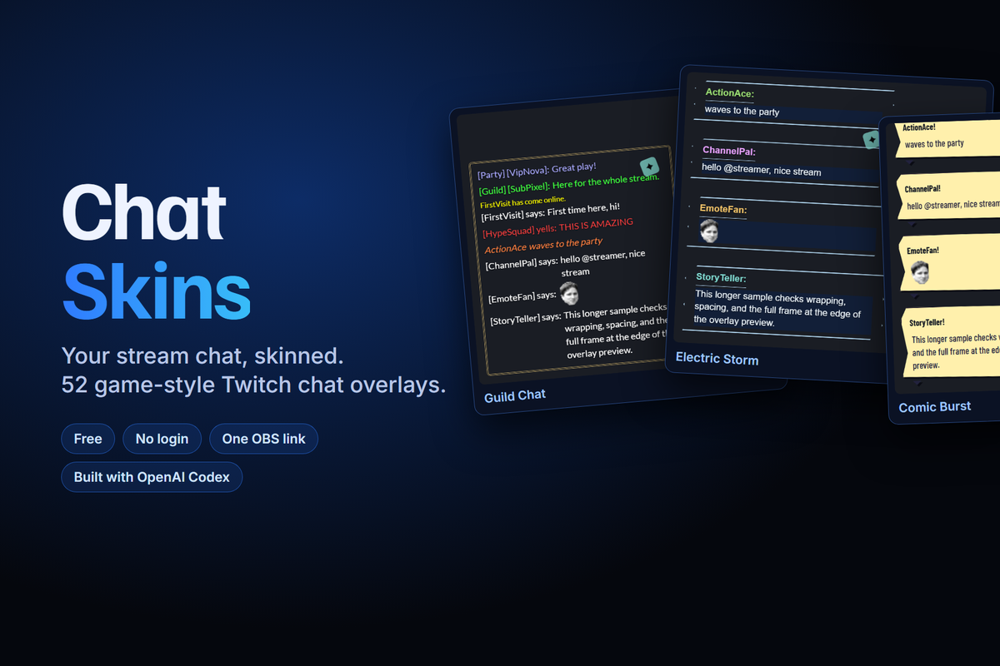](https://youtu.be/QlA6KcXjcl8)

ChatSkins is a browser-based editor for Twitch chat overlays. It's built for the **Codex x TwitchCon Hackathon (2026)**. Streamers pick a one-click look inspired by popular game chats, like MMO guild chat, retro RPG dialog boxes or pixel sandbox chat, then change anything about it. No account and no install needed. Twitch login is optional and only unlocks alerts and channel points. The overlay link *is* the whole configuration.

**Live site:** https://getchatskins.com/

[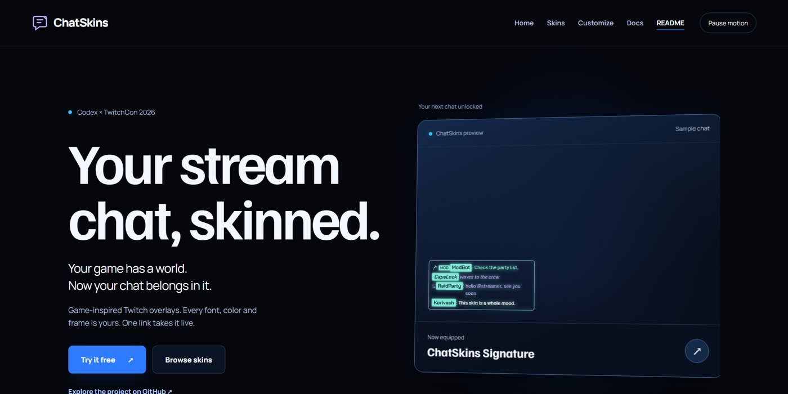](https://getchatskins.com/readme.html)
**[Open the animated, interactive README →](https://getchatskins.com/readme.html)** (live skins, a chat-play demo, the Codex agent story)

## Demo

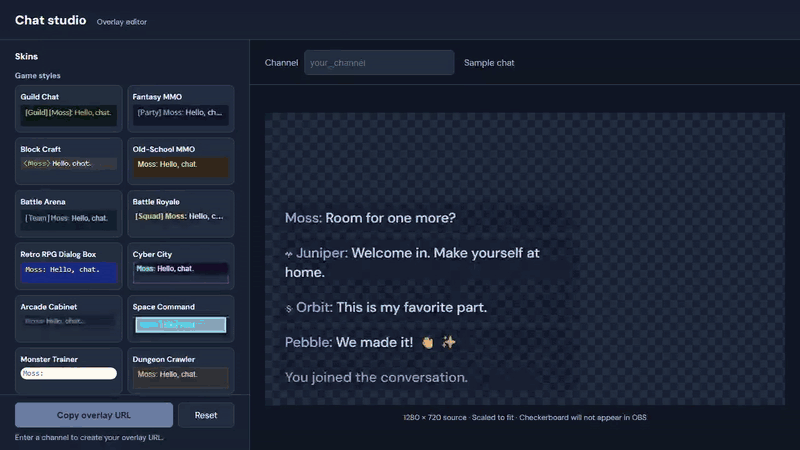

**▶ Watch on YouTube:** https://youtu.be/QlA6KcXjcl8

**Full demo** (2:17, narrated, original music): [docs/media/demo.mp4](docs/media/demo.mp4). Recorded on the live site: hand-painted frames, a **real Twitch chat** test with `!skin` switching live, an AI-painted frame made from one sentence, the Ask ChatSkins guide, Frame Studio, Place it, styling, viewer features (and the one switch that turns chat commands off), and how the Codex agent team built it.

**How we built it** (2:36, narrated, original music): [docs/media/making-of.mp4](docs/media/making-of.mp4). It covers the idea, the agent team (Astra designs, Luna builds, Claude tests and ships), a real prompt, Astra's mockups, a live Luna build log, testing the full skin catalog through the real overlay, and the 31-session / 120-commit loop.

### Frames: hand-painted, made yours
18 illustrated frames. Your channel name sits on the plaque in a font that matches the art, and you pick the frame color, glow, the background behind chat (with opacity) and animated accents. Matching webcam frames are included for some.

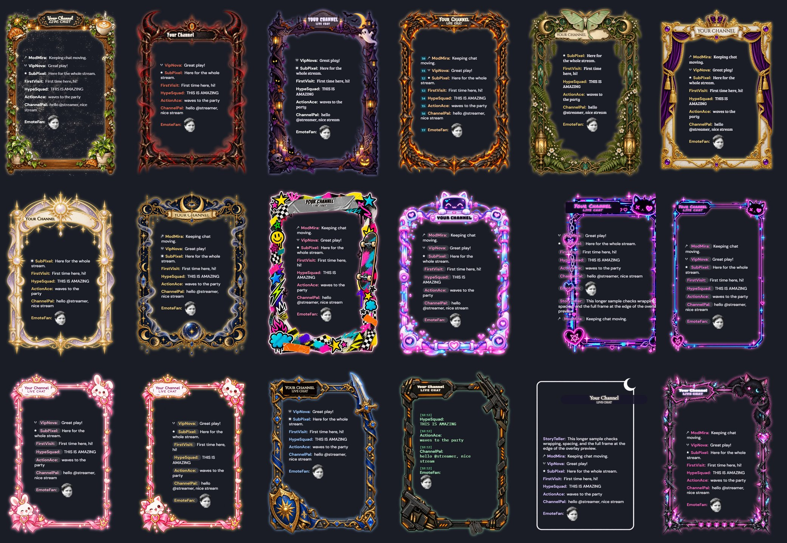

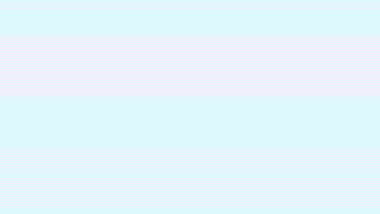

Full-quality clip: [docs/media/frames-tour.mp4](docs/media/frames-tour.mp4). Frame art by Korivash and KittyVenom (made with ChatGPT image generation) and by OpenAI Codex image generation; all code by Codex.

### Describe it, get a painted frame
Type what you want ("cozy autumn frame with leaves and a coffee cup") in **Describe your chat** or ask the **Ask ChatSkins** guide. You get a quick preview right away, then in about 15 seconds a hand-painted frame made just for you, with your channel name on the plaque and chat fitted inside the window. It's yours immediately and travels in your OBS link; sharing it to the public gallery is optional and reviewed first.

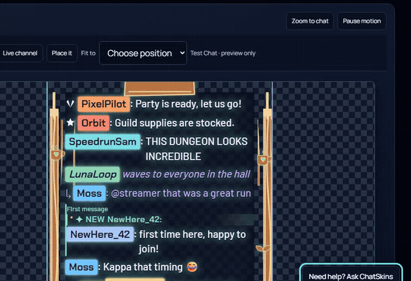

| | |
|---|---|
| 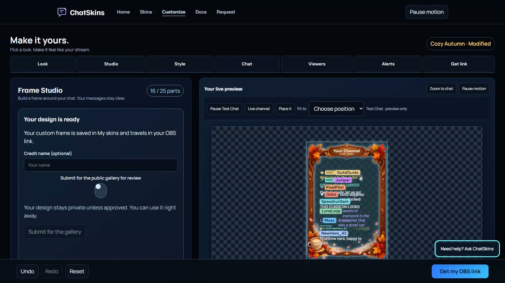 | 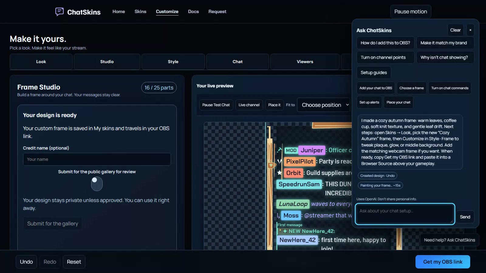 |
| 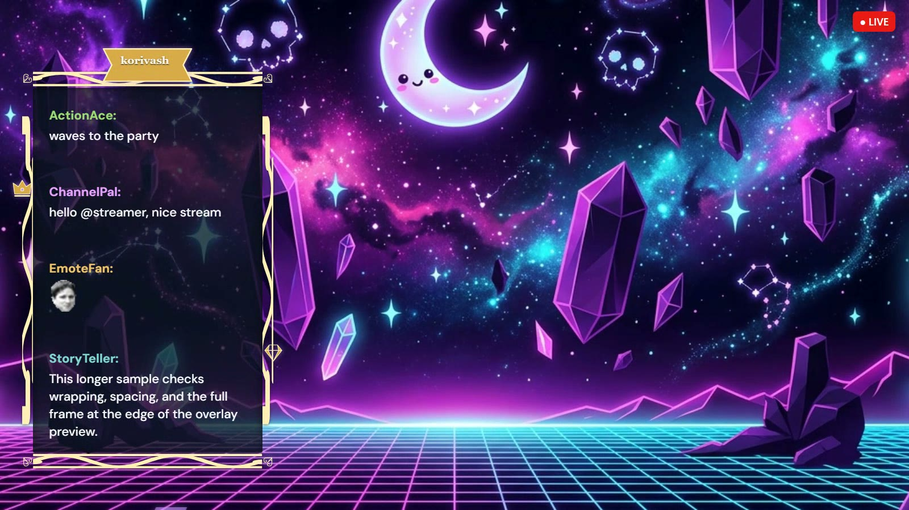 | 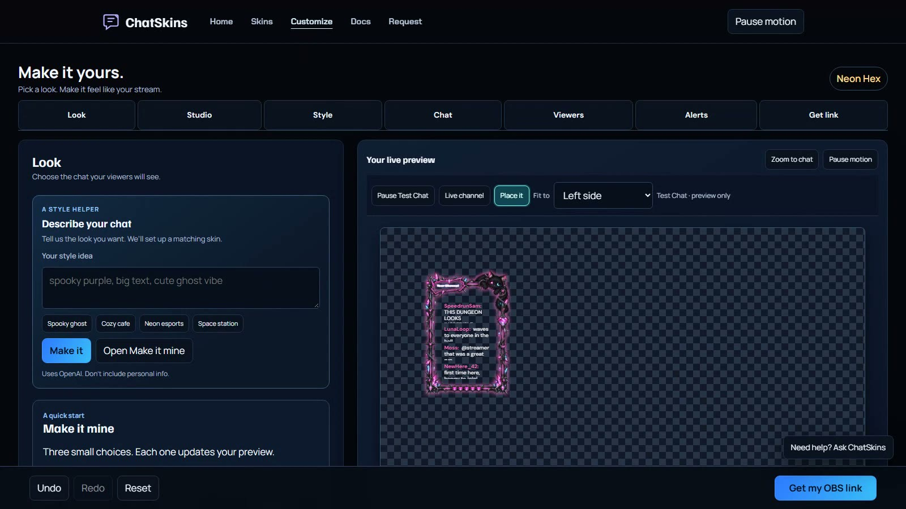 |

**Ask ChatSkins** knows what the editor can do and where, opens the right tab, runs guided walkthroughs (OBS, channel points, alerts) and can apply a style for you. It never shares keys, logs or code. **Frame Studio** builds a frame from 60 parts (borders, corners, stickers, effects). **Place it** lets you drag, resize or snap the chat to a corner.

### Gallery
| | |
|---|---|
| 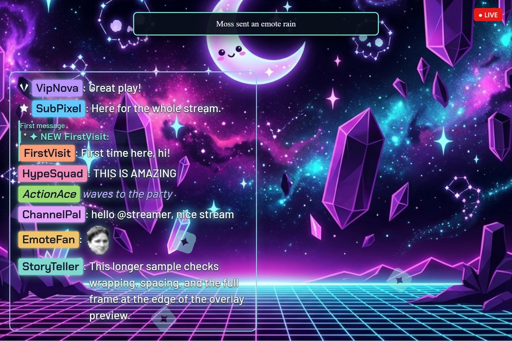 | 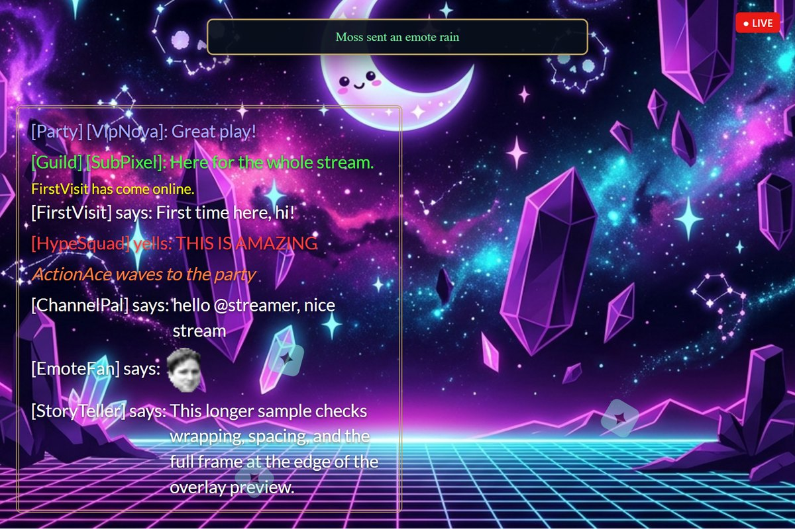 |
| 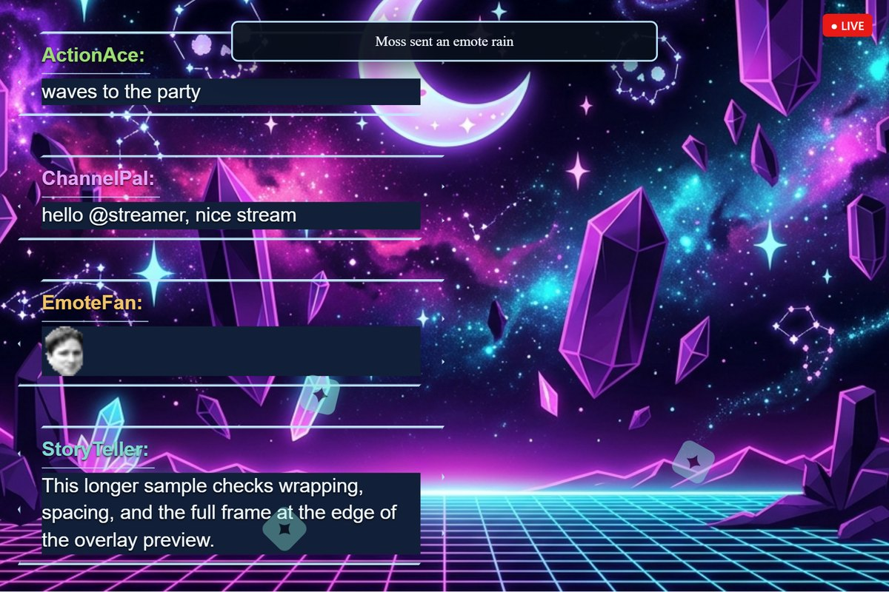 | 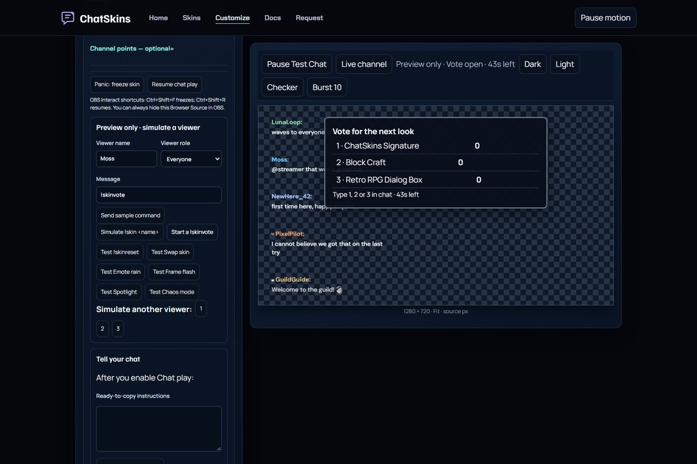 |
| 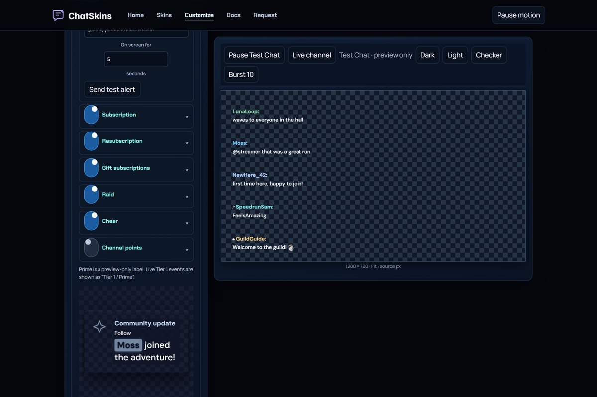 | 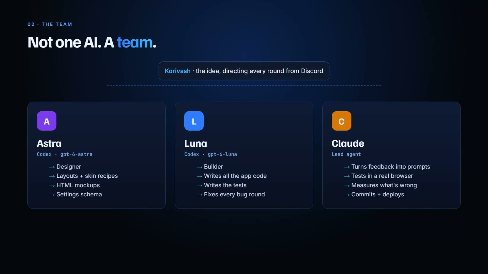 |

### The editor
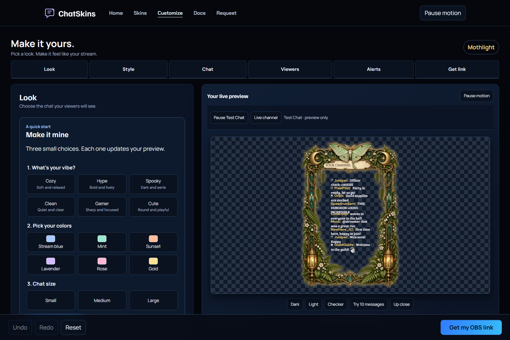

### Skin catalog
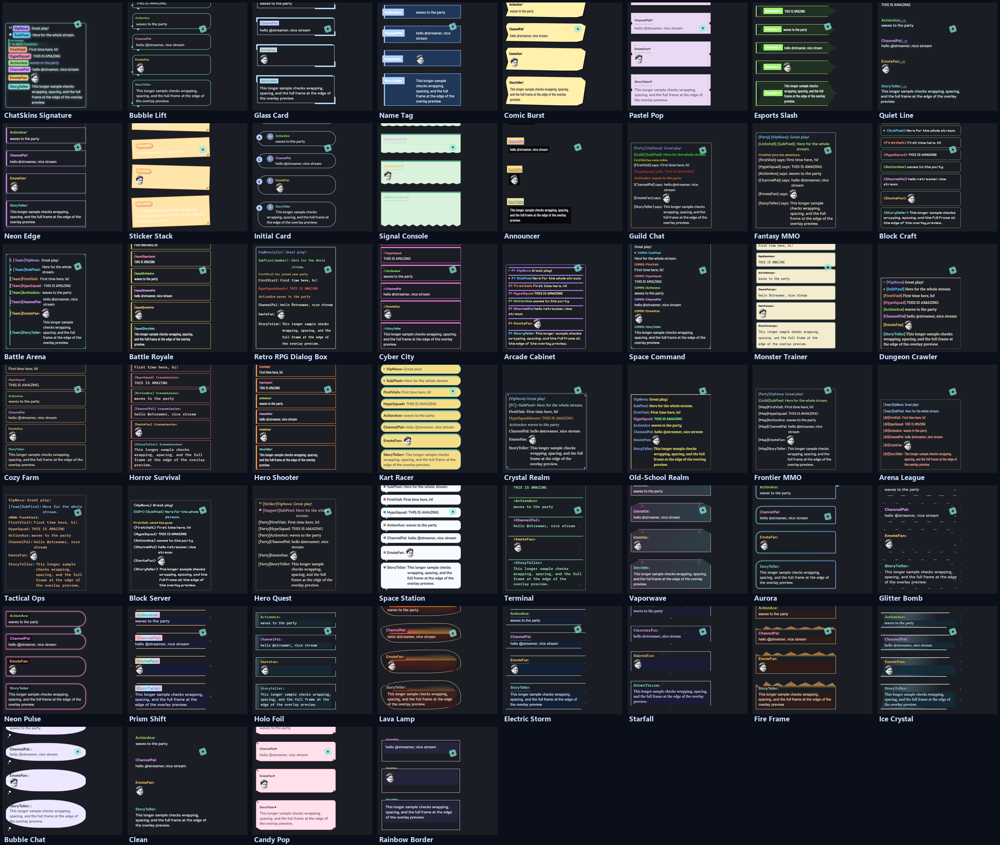

---

## Features

### Chat skins

| Group | Skins |
|---|---|
| Game styles (24) | ChatSkins Signature, Guild Chat, Fantasy MMO, Block Craft, Battle Arena, Battle Royale, Retro RPG Dialog Box, Cyber City, Arcade Cabinet, Space Command, Monster Trainer, Dungeon Crawler, Cozy Farm, Horror Survival, Hero Shooter, Kart Racer, Crystal Realm, Old-School Realm, Frontier MMO, Arena League, Tactical Ops, Block Server, Hero Quest, Space Station |
| Streamer favorites (12) | Bubble Lift, Glass Card, Name Tag, Comic Burst, Pastel Pop, Esports Slash, Quiet Line, Neon Edge, Sticker Stack, Initial Card, Signal Console, Announcer |
| Animated (12) | Terminal, Vaporwave, Aurora, Glitter Bomb, Neon Pulse, Prism Shift, Holo Foil, Lava Lamp, Electric Storm, Starfall, Fire Frame, Ice Crystal |
| Colorful (4) | Bubble Chat, Clean, Candy Pop, Rainbow Border |

## Frame art

Painted chat and matching webcam frames by Korivash and KittyVenom (made with ChatGPT image generation) and by OpenAI Codex image generation. All application code by Codex. Individual frame credits appear in the editor.
